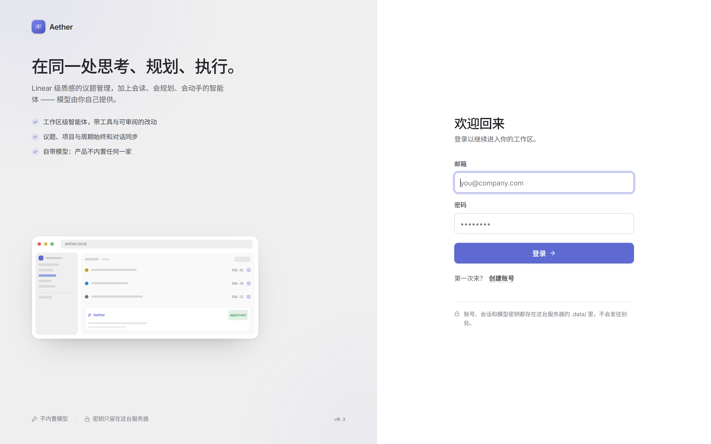
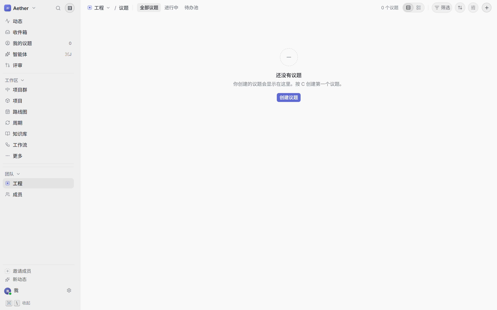
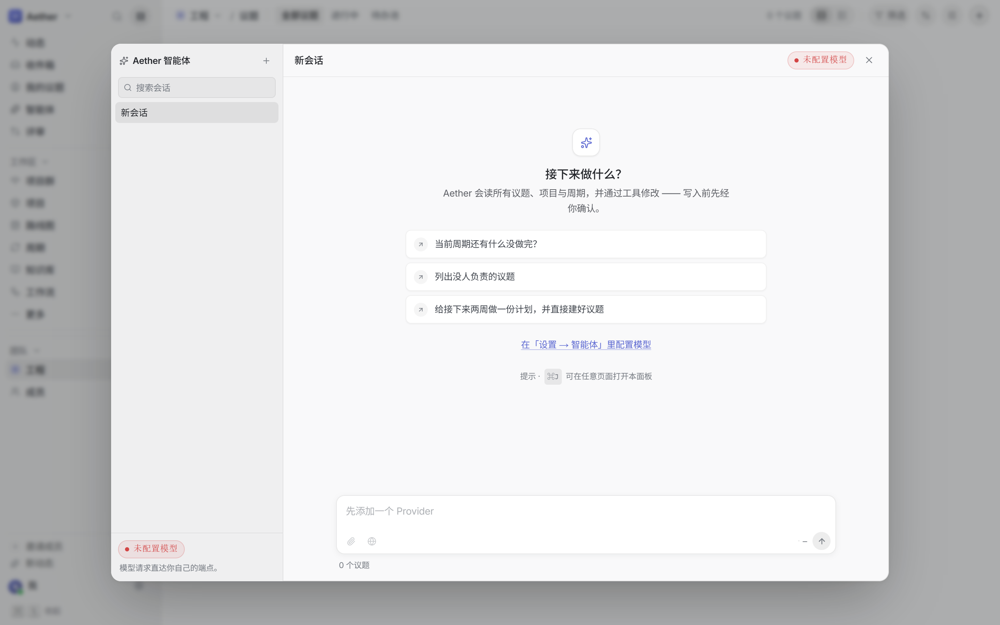
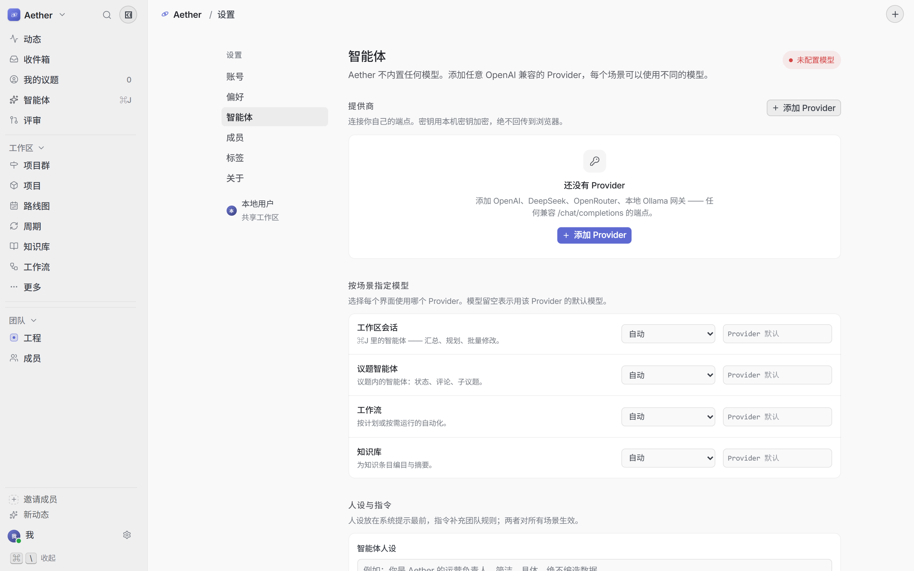
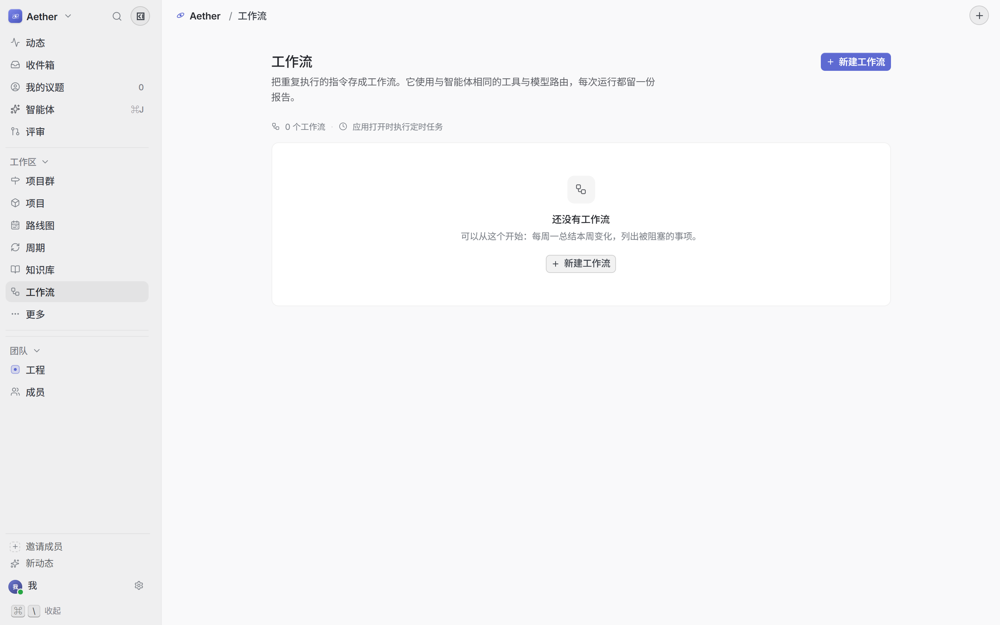
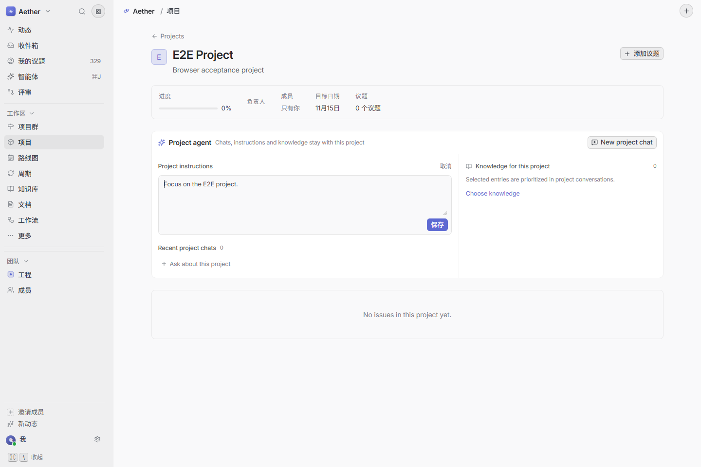

<div align="center">



# Aether

**An agent-centric workspace** — issues, projects, cycles, roadmap and inbox,
with an agent that actually reads and writes the same workspace.

No bundled model: point it at any OpenAI-compatible endpoint and go.

[](https://github.com/crushht/aether/actions/workflows/ci.yml)
[](LICENSE)
[](https://nextjs.org)
[](https://react.dev)
[](https://www.typescriptlang.org)
[](https://www.electronjs.org)

[Quick start](#quick-start) · [Features](#features) · [Agent](#what-the-agent-can-do) · [Architecture](#architecture) · [Roadmap](#roadmap) · [**Download**](https://github.com/crushht/aether/releases/latest) · [中文](README.md)

</div>

---

## Why another workspace

Most "AI workspaces" are a chat box glued to a board: the model cannot see your
data, and even when it can, it cannot change anything.

Aether flips that around — **the agent is the main surface**, and it shares the
same tools, approvals and audit trail as you:

- Ask it to move ENG-42 into this cycle and note the blocker; it edits for real,
  the change lands in history, is undoable and auditable.
- Every write goes through an approval you can grant per call, or "always allow"
  for one tool.
- API keys are encrypted server-side; the browser never receives them again.
- Everything lives locally by default (one JSON snapshot). No upload, no account
  service behind it.

> One line: **Linear's feel + ChatGPT's agent — without picking a model for you.**

<table>
  <tr>
    <td width="50%"></td>
    <td width="50%"></td>
  </tr>
  <tr>
    <td align="center">List / board / grouping / bulk actions</td>
    <td align="center">Agent chat: tool calls, folded steps, approvals</td>
  </tr>
</table>

## Features

### Workspace
| | |
|---|---|
| **Issues** | list and board, sub-issues, relations, checklists, labels, priority, estimates, rich comments with attachments, activity stream, undo/redo |
| **Projects** | health, target date, lead, project updates (attachments + reactions), audit trail, summary export (Markdown / JSON), project templates |
| **Cycles** | create, auto-rollover of unfinished work, start/ending notices, history |
| **Roadmap / Pulse / Reviews** | grouped by project and time, progress and risk in one screen |
| **Inbox** | mentions, agent runs, cycles, project updates, daily digest; filters, bulk read/archive, context menu, day grouping |
| **Knowledge & docs** | tags, pinning, import, export, copy; docs are directly usable by the agent |
| **Search** | issues / projects / docs / knowledge in one page, hit highlighting, snippets, keyboard selection, recent queries |
| **Command palette** | `⌘K`: navigate, create, switch views, run workflows, apply templates |

### Agent
- **Multiple providers**: OpenAI, DeepSeek, OpenRouter, Moonshot, Zhipu GLM, Ollama / LM Studio, any self-hosted endpoint
- **Per-scene routing**: workspace chat, issue panel, project and workflows each pick their own provider and model
- **Tool calls**: read/write issues, projects, knowledge, memory and workflows, with one readable line per step
- **Web access**: `web_search` across a chain of engines (DuckDuckGo → Bing → Sogou → Baidu → 360) and `fetch_url` for page text plus outbound links, with every redirect hop re-validated and private addresses refused. The source is a setting — **Settings → Web search** reorders the chain or pins a SearXNG endpoint (JSON first, HTML when the instance disables `format=json`), and `AETHER_SEARCH_URL` remains the read-only fallback
- **Static triage**: `inspect_artifact` on an attachment or pasted blob — format and magic bytes, PE / ELF / Mach-O headers, ZIP / APK listings, entropy (packed or not), ASCII and UTF-16 strings, URL / IP / command / API indicators, embedded base64/hex payloads and a hex dump; read-only, never executes the sample
- **Approvals**: confirm each write, or "always allow" a tool (stored per account in this browser)
- **Memory and retrieval**: scoped memories plus keyword retrieval; add an embedding model for hybrid reranking
- **Workflows**: scheduled or manual runs, traceable history, cancellation, export
- **Usage**: today / last 7 days of tokens, steps, tool calls and failures (local only)

<p align="center"></p>

### Accounts and sign-in
- **Two ways in**: email + password, or an **emailed six-digit code** (10 minutes, 5 attempts, 60-second resend cooldown, 6 per hour per address)
- **Verified sign-up**: with a mail relay configured, new accounts must confirm the mailbox; invite codes still apply
- **Password reset**: by code, and a reset revokes every other session for that account
- **Bring your own SMTP**: host / account / authorization code in Settings → Email; the code is AES-256-GCM encrypted locally and effective immediately (`.env.local` stays as a read-only fallback). **Codes only go to accounts that already exist here and to `AETHER_MAIL_ALLOWLIST`**, so the mailbox never becomes a sender for strangers
- Chinese HTML + plain-text code mail built in; sending uses `node:tls` with no mail library

### Collaboration and reliability
- Accounts, invite codes, member roles (the last owner is protected), session list with UA / IP and "sign out other devices"
- Notification preferences (per-kind toggles + quiet hours), desktop notifications, daily digest
- **Local-first**: atomic writes, in-process lock, optimistic concurrency (409 conflicts can be compared and merged)
- **Automatic backups**: snapshot before every write, keep 10, preview the diff before restoring
- English/Chinese UI, light/dark, mobile down to 375px, CSP report-only mode with violation logging

<table>
  <tr>
    <td width="33%"></td>
    <td width="33%"></td>
    <td width="33%"></td>
  </tr>
  <tr>
    <td align="center">Workflows and run history</td>
    <td align="center">Project space (agent + knowledge + instructions)</td>
    <td align="center">Phone (375px)</td>
  </tr>
</table>

## Quick start

Requires **Node 20+** (22 recommended).

```bash
git clone https://github.com/crushht/aether.git
cd aether
npm ci

# browser mode: the frontend and the API are the same Next process
npm run dev          # http://127.0.0.1:4321
```

The first visit asks you to create an account (stored locally: password hash + session table).

**Windows shortcuts**: double-click `start.cmd` (browser) or `打开软件.cmd` (desktop).
On the command line: `start.ps1 -Desktop` / `-Prod` / `-Port 4400` / `-AuthDisabled` / `-Fresh`.

### Desktop app

```bash
npm run desktop:dev   # dev: Next + Electron together
npm run dist          # installers into dist/ (nsis + portable)
npm run dist:dir      # unpacked folder only (fastest)
```

The desktop shell adds window-state memory, a tray (show / minimize to tray / quit),
`aether://issue/<id>` deep links, and a static update-manifest check (`AETHER_UPDATE_URL`).

## Connecting a model

Settings → Agents → add a provider:

| Field | Notes |
|---|---|
| Base URL | any OpenAI-compatible endpoint, e.g. `https://api.deepseek.com/v1`, `http://127.0.0.1:11434/v1` |
| API key | encrypted server-side; the browser never gets it back |
| Default model | press "Test connection" to fetch the upstream catalogue, then click a chip |
| Temperature / max steps / context | 0.2–0.4 works well for tool use; context drives the usage meter |

Then map chat, issues, projects and workflows to a provider under "Model per scene".

> No bundled model, no proxy key pool, no shared quota. You choose the model and pay for it.

## Architecture

```
app/            Next.js App Router: pages + /api routes (one process)
components/     UI (workspace / agent / domain components)
lib/
  agent/        provider calls, tools, workflows, retrieval, memory, usage
  store/        client state (zustand) + local persistence
  server/       JSON snapshot, locks, backups, rate limiting, embeddings
desktop/        Electron main process (tray, deep links, window state, updates)
scripts/        regression, e2e (CDP), packaging, icon generation, i18n and CSP checks
```

Data lives in `.data/` by default (override with `LAB_DATA_DIR`): one JSON snapshot,
an accounts file and a backup directory. Writes go "read → check version → atomic
replace → broadcast over SSE", so multiple tabs never clobber each other.

## Development and verification

```bash
npm run typecheck    # tsc --noEmit
npm run lint         # eslint, 0 problems
npm test             # pure-function regression (mail rules, SMTP framing, search parsing, artifact triage)
npm run i18n         # missing keys + hardcoded CJK scan (0 missing / 0 hardcoded)
npm run build        # production build
npm run csp:check    # summarise CSP reports (AETHER_CSP_ENFORCE=1 to enforce)
```

Browser acceptance (Node's built-in WebSocket + CDP, no third-party dependency):

```bash
$env:AUTH_DISABLED='1'; $env:LAB_DATA_DIR='.e2e-data'; npm run dev
node scripts/e2e.mjs            # plus 70+ e2e-*.mjs suites
```

To exercise the emailed code without reading the mailbox: `$env:AETHER_EMAIL_ECHO='1'` — the endpoint also returns `devCode` (local only).

## Autopilot

`scripts/autopilot.mjs` is the delivery loop: read the first item in `NEXT.md` → hand it to a headless agent →
run the gates (typecheck / regression / build) → commit locally only when every gate is green; `--push` pushes.

```bash
npm run autopilot:status                 # queue, candidates, last gates, git state
npm run autopilot                        # one round
node scripts/autopilot.mjs --rounds 3
node scripts/autopilot.mjs --until-dry
node scripts/autopilot.mjs --check       # gates only (what CI should run)
node scripts/autopilot.mjs --seed        # promote candidates from docs/11-产品差距清单.md
```

## Docs

- [Connecting a model](docs/04-接入模型.md) · [Deployment](docs/05-部署.md) · [Desktop app](docs/06-桌面应用.md) · [Product architecture](docs/07-Aether产品架构.md)
- [Gap list vs Linear / ChatGPT](docs/11-产品差距清单.md) · [Autopilot loop](docs/12-自主改进循环.md)
- Changes: [CHANGELOG.md](CHANGELOG.md) · Contributing: [CONTRIBUTING.md](CONTRIBUTING.md)

## Keyboard

| Key | Action |
|---|---|
| `⌘K` / `Ctrl+K` | command palette |
| `C` | new issue |
| `⌘J` | open the agent |
| `⌘\` | collapse the sidebar (drawer on narrow screens) |
| `G` then `I/M/P/R/C/K/W/S` | inbox / my issues / projects / roadmap / cycles / knowledge / workflows / settings |
| `J` / `K` | move within a list |
| `Esc` | close overlays, clear selection |

## Roadmap

- [ ] Multiple workspaces (partition data and routes by `workspaceId`)
- [ ] Auto-update and code signing (release host + certificate)
- [ ] Server-side search index (knowledge search is in-memory today)
- [ ] Sharded storage (large workspaces rewrite too much)
- [ ] SMTP settings page (configure the relay in the UI instead of `.env.local`)
- [ ] Agent tool result cards (search hits and triage reports expandable in the transcript)

What has already landed is recorded in [IMPROVEMENTS.md](IMPROVEMENTS.md).

## Contributing

Issues and pull requests are welcome. Before pushing:

```bash
npm run typecheck && npm run lint && npm test && npm run i18n && npm run build
```

UI copy always goes through `t('English key')`; Chinese lives in `lib/locales/zh.ts`
(missing keys fail `npm run i18n`). See [CONTRIBUTING.md](CONTRIBUTING.md).

## License

[MIT](LICENSE). Font and clean-room notices: [NOTICE.md](NOTICE.md).
