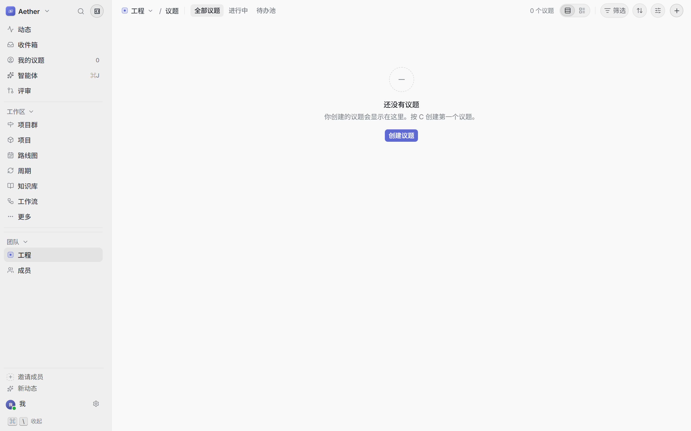
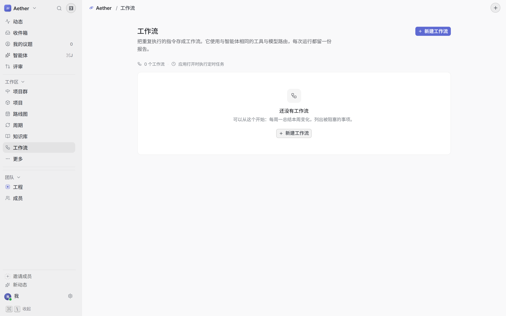

<div align="center">


# Aether

**以 Agent 为中心的工作台** —— 议题、项目、周期、路线图与收件箱，
外加一个真能读写你工作区的智能体。

不内置任何模型：填入任意 OpenAI 兼容端点，就能用。

[](https://github.com/crushht/aether/actions/workflows/ci.yml)
[](LICENSE)
[](https://nextjs.org)
[](https://react.dev)
[](https://www.typescriptlang.org)
[](https://www.electronjs.org)

[快速开始](#快速开始) · [功能](#功能) · [Agent](#agent-能做什么) · [架构](#架构) · [路线图](#路线图) · [**下载桌面版**](https://github.com/crushht/aether/releases/latest) · [English](README.en.md)

</div>

---

## 为什么又做一个工作台

大多数「AI 工作台」是聊天框旁边贴一块看板：模型看不见你的数据，看见了也改不动。
Aether 反过来——**Agent 是主线**，它和工作区共用同一套工具、权限和审计：

- 你让它「把 ENG-42 挪到本周，顺手补一句阻塞说明」，它真的会改，改动进历史、可撤销、可审计；
- 写操作先经过审批，你可以逐个确认，也可以「总是允许」某个工具；
- 密钥加密存在服务端，浏览器永远拿不到明文；
- 所有内容默认落在本机（一个 JSON 快照），不上传、不需要账号体系也能跑。

> 一句话：**Linear 的手感 + ChatGPT 的 Agent，但不替你选模型。**

<table>
  <tr>
    <td width="50%"></td>
    <td width="50%"></td>
  </tr>
  <tr>
    <td align="center">议题 / 看板 / 分组 / 批量操作</td>
    <td align="center">Agent 会话：工具调用、步骤折叠、审批</td>
  </tr>
</table>

## 功能

### 工作区
| | |
|---|---|
| **议题** | 列表与看板、子议题、关联、清单、标签、优先级、估点、评论（富文本 + 附件）、活动流与撤销/重做 |
| **项目** | 健康度、目标日期、负责人、项目更新（含附件与回应）、审计记录、摘要导出（Markdown / JSON）、项目模板 |
| **周期** | 创建、自动延续未完成议题、开始/结束提示、历史 |
| **路线图 / Pulse / 评审** | 按项目与时间聚合，一屏看完进度与风险 |
| **收件箱** | 提及、Agent、周期、项目更新、每日摘要；分类与归档筛选、批量已读/归档、右键菜单、日期分组 |
| **知识库与文档** | 标签、置顶、导入、导出、条目复制；文档可被 Agent 直接引用 |
| **搜索** | 议题 / 项目 / 文档 / 知识一站搜，命中高亮、片段、键盘选择、最近查询 |
| **命令面板** | `⌘K` 全局动作：跳转、新建、切换视图、运行工作流、应用到模板 |

### Agent
- **多 Provider**：OpenAI、DeepSeek、OpenRouter、Moonshot、智谱 GLM、Ollama / LM Studio、任意自建端点
- **按场景路由**：工作区聊天、议题面板、项目、工作流各自选 Provider 与模型
- **工具调用**：读写议题 / 项目 / 知识 / 记忆 / 工作流，一步一句可读的说明
- **联网**：`web_search` 多引擎链（DuckDuckGo → Bing → 搜狗 → 百度 → 360，可用 `AETHER_SEARCH_URL` 指向 SearXNG）+ `fetch_url` 读正文与外链（重定向逐跳校验，私网地址拒绝）
- **静态逆向**：`inspect_artifact` 对附件或粘贴内容做分诊 —— 格式与 magic、PE / ELF / Mach-O 头、ZIP / APK 目录、熵（是否加壳）、ASCII 与 UTF-16 字符串、URL / IP / 命令 / API 指示器、内嵌 base64/hex 载荷、hexdump；只读，不执行样本
- **审批**：写工具逐次确认，或「总是允许」（按账号保存在本浏览器）
- **记忆与知识**：作用域记忆 + 关键词检索，配了向量模型就自动混合重排
- **工作流**：定时或手动运行，运行记录可回溯、可取消、可导出
- **用量**：今日 / 近 7 天的 token、步骤、工具调用与失败数（仅本浏览器统计）

<p align="center"></p>

### 账号与登录
- **两种登录**：邮箱 + 密码；或**邮箱验证码**（六位数字，10 分钟有效、5 次尝试、60 秒重发冷却、每小时最多 6 封）
- **注册即验证**：配好 SMTP 中继后，新账号必须先通过邮件验证码，邀请码照旧生效
- **找回密码**：验证码重置，重置即吊销该账号其它设备会话
- **自带 SMTP**：设置 → 邮件里填主机 / 账号 / 授权码（QQ 邮箱用 16 位授权码；也支持 Gmail / 163 / Outlook / 任意中继、STARTTLS），
  授权码用 AES-256-GCM 加密保存在本机数据目录，**保存即生效**、不用重启；「测试连接」与「发送测试邮件」先验一遍。
  `.env.local` 仍可用作只读回退（容器部署），已保存的设置优先
- 中文验证码邮件模板（HTML + 纯文本双版本），发送走 `node:tls`，不引入任何邮件库

### 协作与可靠性
- 账号、邀请码、成员角色（最后一位 owner 受保护）、会话列表（UA / IP / 撤销其它设备）
- 通知偏好（分类开关 + 免打扰时段）、桌面通知、每日摘要
- **本地优先**：原子写 + 进程内锁 + 乐观并发（409 冲突可对比合并）
- **自动备份**：写前快照、保留 10 份、恢复前可预览差异（会带回什么、会丢掉什么）
- 中英双语、深浅色、移动端适配（375px 起）、CSP 观察期与违规落盘

<table>
  <tr>
    <td width="33%"></td>
    <td width="33%"></td>
    <td width="33%"></td>
  </tr>
  <tr>
    <td align="center">工作流与运行历史</td>
    <td align="center">项目空间（Agent + 知识 + 指令）</td>
    <td align="center">手机（375px）</td>
  </tr>
</table>

## 快速开始

需要 **Node 20+**（推荐 22）。

```bash
git clone https://github.com/crushht/aether.git
cd aether
npm ci

# 浏览器模式：前后端同一个 Next 进程
npm run dev          # http://127.0.0.1:4321
```

首次打开会让你创建账号（本地保存，密码哈希 + 会话表）。

**Windows 可以更省事**：项目根目录双击 `start.cmd`（浏览器）或 `打开软件.cmd`（桌面版）；
命令行则用 `start.ps1 -Desktop` / `-Prod` / `-Port 4400` / `-AuthDisabled` / `-Fresh`。

### 桌面版

```bash
npm run desktop:dev   # 开发模式：Next + Electron 一起起
npm run dist          # 打包安装包与便携版到 dist/
# 或只打包可运行目录（最快）
npm run dist:dir
```

桌面版额外提供：窗口状态记忆、托盘（显示 / 最小化到托盘 / 退出）、
`aether://issue/<id>` 深链唤起，以及静态更新清单检查（`AETHER_UPDATE_URL`）。

## 接入模型

设置 → Agents → 添加 Provider：

| 字段 | 说明 |
|---|---|
| Base URL | 任意 OpenAI 兼容端点，如 `https://api.deepseek.com/v1`、`http://127.0.0.1:11434/v1` |
| API Key | 服务端加密保存，浏览器不再收到明文 |
| 默认模型 | 点「测试连接」会从上游拉取模型列表，点一下即可设为默认 |
| 温度 / 最大步数 / 上下文 | 温度 0.2–0.4 适合工具调用；上下文用于用量提示 |

然后到「按场景路由」把聊天、议题、项目、工作流分别指到某个 Provider。

> 没有内置模型、没有代理密钥池、没有共享额度。用哪个模型、花谁的钱，由你决定。

## 架构

```
app/            Next.js App Router：页面 + /api 路由（同一个进程）
components/     UI（工作台 / Agent / 领域组件）
lib/
  agent/        Provider 调用、工具、工作流、检索、记忆、用量
  store/        客户端状态（zustand）+ 本地持久化
  server/       JSON 快照、锁、备份、限流、向量
desktop/        Electron 主进程（托盘、深链、窗口状态、更新检查）
scripts/        回归、e2e（CDP）、打包、图标生成、i18n 与 CSP 检查
```

数据默认落在 `.data/`（可用 `LAB_DATA_DIR` 改）：一个 JSON 快照 + 账号文件 + 备份目录。
写入路径是「读 → 校验版本 → 原子替换 → 广播 SSE」，因此多标签页不会互相覆盖。

## 开发与验证

```bash
npm run typecheck    # tsc --noEmit
npm run lint         # eslint，0 problems
npm test             # 纯函数回归（含邮件规则 / SMTP 组帧 / 搜索解析 / 静态逆向）
npm run i18n         # 缺键 + 硬编码中文扫描（0 missing / 0 hardcoded）
npm run build        # 生产构建
npm run csp:check    # CSP 违规汇总（AETHER_CSP_ENFORCE=1 可切强制）
```

浏览器验收（Node 内置 WebSocket + CDP，无第三方依赖）：

```bash
$env:AUTH_DISABLED='1'; $env:LAB_DATA_DIR='.e2e-data'; npm run dev
node scripts/e2e.mjs            # 另有 70+ 个 e2e-*.mjs 覆盖各功能
```

想发真实验证码又不想读邮箱：`$env:AETHER_EMAIL_ECHO='1'`，接口会把 `devCode` 一起返回（仅本地）。

## 自主改进循环

`scripts/autopilot.mjs` 是这个仓库的「持续交付司机」：读 `NEXT.md` 的待办 → 交给 headless agent →
跑门禁（typecheck / regression / build）→ 门禁全绿才本地提交，`--push` 才推送。

```bash
npm run autopilot:status                 # 队列 / 候选 / 上次门禁 / git 状态
npm run autopilot                        # 跑一轮
node scripts/autopilot.mjs --rounds 3    # 连跑三轮
node scripts/autopilot.mjs --until-dry   # 跑到队列为空
node scripts/autopilot.mjs --check       # 只跑门禁（CI 用这个）
node scripts/autopilot.mjs --seed        # 从 docs/11-产品差距清单.md 取候选进队列
```

细节与安全边界见 [docs/12-自主改进循环.md](docs/12-自主改进循环.md)。

## 文档

- [接入模型](docs/04-接入模型.md) · [部署](docs/05-部署.md) · [桌面应用](docs/06-桌面应用.md) · [产品架构](docs/07-Aether产品架构.md)
- [产品差距清单（对标 Linear / ChatGPT）](docs/11-产品差距清单.md) · [自主改进循环](docs/12-自主改进循环.md)
- 变更记录：[CHANGELOG.md](CHANGELOG.md)；贡献方式：[CONTRIBUTING.md](CONTRIBUTING.md)

## 键盘

| 键 | 作用 |
|---|---|
| `⌘K` / `Ctrl+K` | 命令面板 |
| `C` | 新建议题 |
| `⌘J` | 唤出 Agent |
| `⌘\` | 收起侧栏（窄屏为抽屉） |
| `G` 然后 `I/M/P/R/C/K/W/S` | 跳到收件箱 / 我的议题 / 项目 / 路线图 / 周期 / 知识 / 工作流 / 设置 |
| `J` / `K` | 列表内上下移动 |
| `Esc` | 关闭浮层、清空选择 |

## 路线图

- [ ] 多工作区（按 `workspaceId` 分区数据与路由）
- [ ] 自动更新与代码签名（发布源 + 证书）
- [ ] 服务端搜索索引（知识库目前是内存检索）
- [ ] 数据层分片（大工作区写入放大）
- [x] 邮件服务设置页（SMTP 可视化配置，替代 `.env.local`）
- [ ] Agent 工具结果卡片化（搜索结果 / 逆向报告在对话流内展开）

已经落地的改动记在 [IMPROVEMENTS.md](IMPROVEMENTS.md)。

## 贡献

欢迎 issue 与 PR。提交前请保证：

```bash
npm run typecheck && npm run lint && npm test && npm run i18n && npm run build
```

界面文案统一走 `t('English key')`，中文写在 `lib/locales/zh.ts`（缺键会被 `npm run i18n` 拦下）。

## 许可

[MIT](LICENSE)。字体与独立实现声明见 [NOTICE.md](NOTICE.md)。
